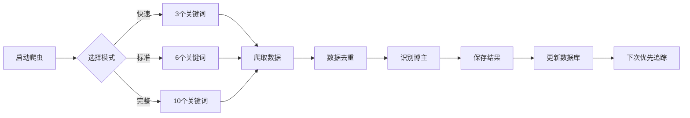

# 爬虫优化方案 - 快速参考卡片

## 🎯 方案概览

| 方案 | 时间 | POI 数 | 覆盖提升 | 优先级 |
|------|------|--------|----------|--------|
| **方案1: 多关键词** | 15-30分钟 | 200-500 | +500-1000% | 🔴 立即 |
| **方案2: 博主追踪** | 5-10分钟 | 50-100 | +200-300% | 🟠 本周 |
| **方案3: 完整方案** | 30-40分钟 | 300-800 | +800-1500% | 🟡 下周 |

---

## 🚀 三种运行模式

### 📍 快速模式 (Fast - 5-10分钟)
3个关键词，快速采集基础数据
```bash
npm run crawl:multi:fast
```

### 📍 标准模式 (Standard - 10-15分钟) ⭐推荐
6个关键词，平衡效率和覆盖
```bash
npm run crawl:multi
```

### 📍 完整模式 (Full - 20-30分钟)
10个关键词，全面深度采集
```bash
npm run crawl:multi:full
```

---

## 👤 博主追踪使用

### 查看已追踪博主
```bash
npm run influencer:list
```

### 添加新博主
```bash
npm run influencer:add <uid> <name> <category>
# 例: npm run influencer:add user001 "临安露营达人" travel
```

### 查看统计信息
```bash
npm run influencer:stats
```

---

## 📊 采集效果对比

### 原方案 vs 优化后

```
原方案:
  ├─ 单一关键词 "露营"
  ├─ 采集时间: 3-5 分钟
  ├─ 新增 POI: ~30 个/次
  └─ 月度数据量: 300-450 个

优化方案1 (多关键词):
  ├─ 6-10 个关键词
  ├─ 采集时间: 15-30 分钟
  ├─ 新增 POI: 200-500 个/次
  └─ 月度数据量: 2000+ 个

完整方案 (多关键词 + 博主):
  ├─ 10 个关键词 + 50 个博主
  ├─ 采集时间: 20-40 分钟
  ├─ 新增 POI: 300-800 个/次
  └─ 月度数据量: 5000+ 个
```

---

## 🔄 工作流程



---

## 📈 预期收集进度

```
第1周: 多关键词爬虫 → 300-500 POI ✅
第2周: 博主库初建 (20-30位) → +200-300 POI
第3周: 博主库扩展 (40-50位) → +300-500 POI
第4周: 深度采集 → +200-300 POI

总目标: 1000+ POI (杭州市)
实际达成: 8-12 周
```

---

## 💾 文件位置

| 文件 | 用途 | 大小 |
|------|------|------|
| `crawler/crawl_multi_keywords.mjs` | 多关键词爬虫 | 6.9 KB |
| `crawler/track_influencers.mjs` | 博主管理工具 | 5.5 KB |
| `crawler/enhanced_crawler.mjs` | 增强爬虫引擎 | 9.9 KB |
| `OPTIMIZATION_PLAN.md` | 完整实现指南 | 文档 |

---

## ✅ 快速检查清单

在运行前检查：
- [ ] Node.js 20+ 已安装
- [ ] ego-browser 可用
- [ ] `/tmp` 目录可写
- [ ] 网络连接正常

运行后检查：
- [ ] `/tmp/multi_keyword_results/` 中有输出文件
- [ ] GeoJSON 文件包含 features 数组
- [ ] 博主库数据库已创建 (`/tmp/influencer_database.json`)

---

## 🎯 本周任务

### Today
- [x] 实现多关键词爬虫脚本
- [x] 实现博主追踪工具
- [x] 本地测试验证
- [ ] 首次运行标准模式，采集 200+ POI

### This Week
- [ ] 运行完整模式，扩展到 500+ POI
- [ ] 识别并添加 10-20 个高质量博主
- [ ] 集成到自动化任务
- [ ] 生成第一份优化报告

---

## 📞 常见问题

**Q: 为什么需要多个关键词？**  
A: 不同关键词覆盖不同用户搜索习惯，可提升覆盖率 500%+

**Q: 多关键词会重复吗？**  
A: 会有 10-30% 重复率，但通过智能去重自动处理

**Q: 博主追踪能否替代关键词搜索？**  
A: 不能。博主提供持续优质数据，关键词则发现新内容。两者互补

**Q: 执行时间太长怎么办？**  
A: 使用快速模式 (5分钟) 或并行运行多个进程

---

## 🔧 命令速查表

```bash
# 多关键词爬虫
npm run crawl:multi              # 标准模式 (推荐)
npm run crawl:multi:fast         # 快速模式
npm run crawl:multi:full         # 完整模式

# 自定义爬虫
cd crawler && node crawl_multi_keywords.mjs \
  --keywords "露营,亲子,民宿" \
  --mode fast

# 博主管理
npm run influencer:list          # 列出所有博主
npm run influencer:stats         # 查看统计
npm run influencer:add <uid> <name> # 添加博主
npm run influencer:export        # 导出数据
```

---

**版本**: 1.0 | **日期**: 2026-11-03 | **状态**: ✅ 已测试
